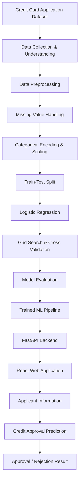

# CreditIQ# 💳 CREDITIQ
### Intelligent Credit Card Approval Prediction System

<p align="center">
  <strong>Smarter Insights. Better Credit Decisions.</strong>
</p>

<p align="center">
  An AI-powered FinTech web application that predicts the likelihood of credit card application approval using Machine Learning, Logistic Regression, and intelligent data analytics.
</p>

<p align="center">
  
  
  
</p>

<p align="center">
  <a href="#-overview">Overview</a> •
  <a href="#-features">Features</a> •
  <a href="#-technology-stack">Tech Stack</a> •
  <a href="#-architecture">Architecture</a> •
  <a href="#-installation--setup">Installation</a> •
  <a href="#-machine-learning-workflow">ML Workflow</a>
</p>

---

## 🌟 Overview

**CREDITIQ** is a Machine Learning-based web application designed to predict whether a credit card application is likely to be approved or rejected.

Traditional credit card application screening involves reviewing applicant information such as income, employment status, financial details, and credit history. This process can become time-consuming when handling large numbers of applications.

CREDITIQ demonstrates how Machine Learning can assist in preliminary credit application screening by analysing historical application data and identifying patterns associated with approval outcomes.

The system uses **Logistic Regression** as its primary classification algorithm, supported by data preprocessing, feature encoding, numerical scaling, and hyperparameter optimization using Grid Search with Cross-Validation.

The application combines a modern FinTech dashboard with an interactive prediction system, model evaluation, dataset management, and visual analytics.

> 🎯 **Our Mission:** Make Machine Learning-powered credit assessment easier to understand through an intelligent, interactive, and visually engaging platform.

---

## ✨ Key Features

### 📊 1. Intelligent Dashboard
- Real-time application statistics.
- Total application overview.
- Approval and rejection analytics.
- Application trend visualizations.
- Income and employment distribution.
- Recent prediction history.
- Model training status.

### 🧠 2. AI-Powered Credit Prediction
- Interactive applicant information form.
- Personal and financial information processing.
- Employment information analysis.
- Logistic Regression-based prediction.
- Approval and rejection probability.
- Instant prediction results.
- Understandable prediction explanations.

### 📈 3. Model Performance Analytics
- Model accuracy.
- Precision.
- Recall.
- F1-score.
- Confusion matrix visualization.
- Classification report.
- Cross-validation results.
- Grid Search optimization results.

### 📁 4. Dataset Management
- CSV dataset upload.
- Dataset preview.
- Missing-value analysis.
- Numerical and categorical feature identification.
- Data validation.
- Model retraining support.

### 📜 5. Application History
- Saved prediction records.
- Application ID tracking.
- Search and filtering.
- Prediction status tracking.
- CSV export.
- Downloadable PDF prediction reports.

### 🎨 6. Premium User Interface
- Modern FinTech SaaS dashboard.
- Responsive design.
- Smooth animations and transitions.
- Interactive charts.
- Elegant cards and visualizations.
- Light and dark themes.
- Mobile-friendly experience.

---

## 🖥️ Application Preview

> Screenshots and product previews will be added as the application development progresses.

| Dashboard | New Prediction |
|---|---|
| Add dashboard screenshot here | Add prediction form screenshot here |

| Prediction Results | Model Analytics |
|---|---|
| Add prediction result screenshot here | Add model analytics screenshot here |

---

## 🛠️ Technology Stack

### Frontend
| Technology | Purpose |
|---|---|
| React | Frontend development |
| TypeScript | Type-safe development |
| Vite | Development and build tooling |
| Tailwind CSS | Styling and responsive UI |
| Shadcn UI | UI components |
| Magic UI | Animated interface components |
| Framer Motion | UI animations |
| Recharts | Data visualization |
| Lucide Icons | Modern iconography |

### Backend
| Technology | Purpose |
|---|---|
| Python | Backend and ML development |
| FastAPI | REST API development |
| SQLite | Application data storage |
| Joblib | Model persistence |

### Machine Learning & Data Science
| Technology | Purpose |
|---|---|
| Scikit-learn | Machine Learning |
| Pandas | Data manipulation |
| NumPy | Numerical operations |
| Logistic Regression | Binary classification |
| GridSearchCV | Hyperparameter optimization |
| StandardScaler | Numerical feature scaling |
| OneHotEncoder | Categorical feature encoding |
| Matplotlib | Data visualization |

### Development Tools
- Google Antigravity IDE
- Git & GitHub
- Lovable MCP
- Magic UI MCP
- MotionSites MCP
- GitHub MCP

---

## 🏗️ System Architecture



---

## 🧠 Machine Learning Workflow

CREDITIQ follows a structured Machine Learning pipeline.

**1. Data Collection**

Collect historical credit card application records containing relevant applicant attributes and approval outcomes.

**2. Data Preprocessing**

- Handle missing values.
- Remove or investigate duplicate records.
- Encode categorical variables.
- Scale numerical features.
- Check class distribution.

**3. Train-Test Splitting**

Separate the dataset into training and testing subsets to evaluate model performance on unseen data.

**4. Model Training**

Train the Logistic Regression classification model.

**5. Hyperparameter Optimization**

Use GridSearchCV with cross-validation to identify suitable model parameters.

**6. Model Evaluation**

Evaluate the model using:

- Accuracy
- Precision
- Recall
- F1-score
- Confusion Matrix

**7. Prediction**

Process new applicant information through the same fitted preprocessing pipeline and generate an approval or rejection prediction.

---

## ⚙️ Installation & Setup

Follow these instructions to run CREDITIQ locally.

### Prerequisites

Install the following:

- Node.js (LTS)
- Python 3.10+
- Git
- npm

### 1. Clone the Repository

```bash
git clone https://github.com/AlokXCreate/creditiq-credit-card-approval-prediction.git
```

```bash
cd creditiq-credit-card-approval-prediction
```

### 2. Setup Backend

Navigate to the backend directory:

```bash
cd backend
```

Create a virtual environment:

```bash
python -m venv venv
```

Activate it on Windows:

```powershell
venv\Scripts\activate
```

Install dependencies:

```bash
pip install -r requirements.txt
```

Start the FastAPI server:

```bash
uvicorn app.main:app --reload
```

Backend URL:

```text
http://127.0.0.1:8000
```

API Documentation:

```text
http://127.0.0.1:8000/docs
```

### 3. Setup Frontend

Open another terminal and navigate to the frontend directory:

```bash
cd frontend
```

Install dependencies:

```bash
npm install
```

Start the development server:

```bash
npm run dev
```

Frontend URL:

```text
http://localhost:5173
```

**Note:** Follow the actual project configuration and README instructions if directory names or startup commands change during development.

---

## 📂 Project Structure

```text
CREDITIQ/
│
├── frontend/
│   ├── public/
│   └── src/
│       ├── components/
│       ├── pages/
│       ├── services/
│       ├── hooks/
│       ├── types/
│       ├── utils/
│       ├── App.tsx
│       └── main.tsx
│
├── backend/
│   ├── app/
│   │   ├── api/
│   │   ├── ml/
│   │   ├── database/
│   │   ├── schemas/
│   │   └── main.py
│   ├── data/
│   ├── saved_models/
│   └── requirements.txt
│
├── docs/
├── screenshots/
├── .gitignore
├── .env.example
└── README.md
```

---

## 📊 Model Evaluation

The Logistic Regression model is evaluated using multiple classification metrics.

| Metric | Description |
|---|---|
| Accuracy | Overall percentage of correct predictions |
| Precision | Proportion of predicted positive cases that are actually positive |
| Recall | Proportion of actual positive cases correctly identified |
| F1-Score | Harmonic mean of precision and recall |
| Confusion Matrix | Shows correct and incorrect classifications |

Actual evaluation results will be generated from the trained model and held-out test dataset.

---

## 🎯 Project Objectives

- Develop an ML-based credit card approval prediction system.
- Automate preliminary application classification.
- Apply appropriate data preprocessing techniques.
- Implement Logistic Regression for binary classification.
- Optimize model parameters using Grid Search.
- Evaluate model performance using multiple metrics.
- Develop a user-friendly web-based prediction interface.
- Demonstrate responsible and explainable AI in financial technology.

---

## 🌍 Sustainable Development Goals

CREDITIQ aligns with the following United Nations Sustainable Development Goals:

| SDG | Goal | Project Contribution |
|---|---|---|
| SDG 8 | Decent Work and Economic Growth | Supports efficient digital financial services. |
| SDG 9 | Industry, Innovation and Infrastructure | Demonstrates AI and ML innovation in FinTech. |
| SDG 10 | Reduced Inequalities | Encourages responsible and fair preliminary screening. |

---

## 🔐 Responsible AI & Privacy

CREDITIQ is designed as an academic decision-support prototype.

- Model predictions are estimates, not guaranteed financial outcomes.
- Historical datasets may contain bias.
- Prediction quality depends on the quality and representativeness of training data.
- Personal and financial information should be handled securely.
- Sensitive attributes must not be used inappropriately.
- Model outputs should not replace authorized human review.
- Actual credit approval remains the responsibility of the relevant financial institution.

---

## 🚀 Future Enhancements

Potential future improvements include:

- Advanced model comparison.
- Explainable AI using SHAP.
- Model fairness evaluation.
- Improved feature engineering.
- Additional credit-risk indicators.
- Advanced model monitoring.
- Secure user authentication.
- Enhanced reporting and analytics.
- Production-grade database integration.

---

## 👨‍💻 Developer

**Alok Anil Kadam**

AI & Data Science Student | AI Engineer | Web Developer

<p>
  <a href="https://github.com/AlokXCreate">
    
  </a>
  <a href="https://www.linkedin.com/in/alokkadam-ai/">
    
  </a>
</p>

---

## 📜 Project Information

**Project Title:** Predicting Credit Card Approval Using Machine Learning

**Application Name:** CREDITIQ

**Domain:** Artificial Intelligence, Machine Learning & Financial Technology

**Primary Algorithm:** Logistic Regression

**Optimization Technique:** Grid Search with Cross-Validation

**Application Type:** Full-Stack Machine Learning Web Application

**Project Category:** Academic / Educational Prototype

---

## ⭐ Support

If you find this project interesting, consider giving the repository a ⭐ on GitHub.

Your support and feedback are appreciated!

---

<p align="center">
  <strong>CREDITIQ</strong>
  <br/>
  Smarter Insights. Better Credit Decisions.
  <br/><br/>
  <sub>Built with ❤️ using Machine Learning & Modern Web Technologies</sub>
</p>
